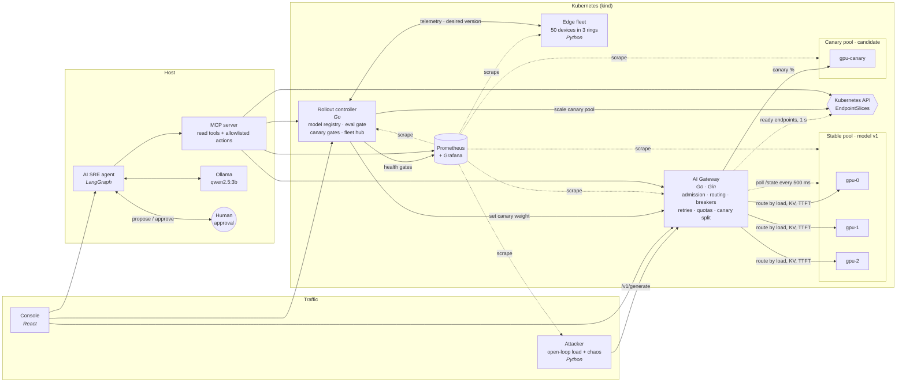
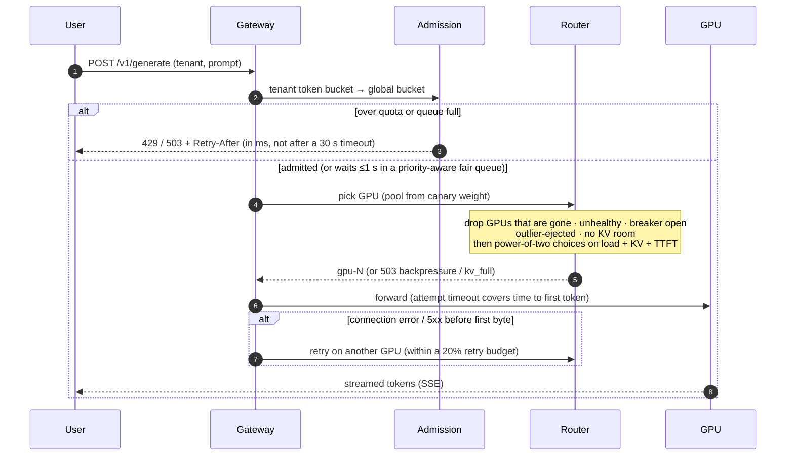
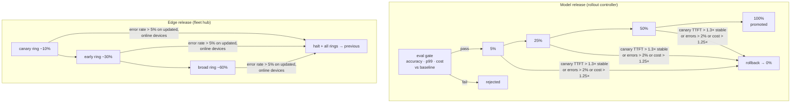
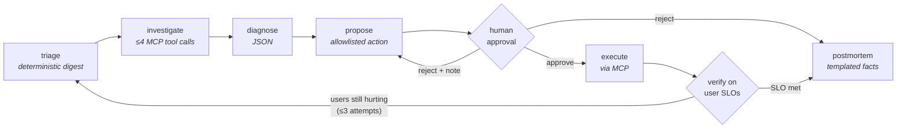

# ⚔️ AI Inference Battlefield

**An LLM serving platform built to be attacked, plus an AI SRE that defends it.**

Most inference demos show the happy path. This one starts by breaking things. A traffic generator and a chaos engine run attacks against a Kubernetes-hosted LLM fleet: 1000 req/s spikes, a GPU that silently slows down, KV-cache exhaustion, pod kills, hung processes, a noisy tenant, a bad model release, edge network partitions. Each attack is measured with the defenses off, then again with the right defenses on. The last mission hands the whole system to an AI agent that detects the incident itself, diagnoses it, proposes a fix, waits for a human to approve it, and then checks whether users actually got better.

Everything runs on one laptop with **no GPUs**: Go, Python, React, Kubernetes (kind), Prometheus, and an open-source model on Ollama.

📄 **[Full design document (PDF, 18 pages)](docs/AI-Inference-Battlefield.pdf)**: HLD, LLD for every component, algorithms, APIs, deployment, results and lessons learned.

<p align="center">
<b>88% → 0%</b> errors under a 10× traffic spike &nbsp;·&nbsp;
<b>3 s</b> to eject a degraded GPU &nbsp;·&nbsp;
<b>5%</b> canary exposure for a bad model &nbsp;·&nbsp;
<b>4 of 50</b> edge devices hit by a broken rollout
</p>

---

## Contents

- [Results](#results)
- [High-level design](#high-level-design)
- [How a request survives](#how-a-request-survives)
- [The control loops](#the-control-loops)
- [The AI SRE](#the-ai-sre)
- [Design decisions](#design-decisions)
- [What the battlefield taught me](#what-the-battlefield-taught-me)
- [Run it](#run-it)
- [Repository layout](#repository-layout)
- [Limitations](#limitations)

---

## Results

All numbers were measured on this machine with [`scripts/experiment.py`](scripts/experiment.py). Each mission's write-up in [missions/](missions/) has the full time series.

| # | Attack | Defenses off | Defenses on |
|---|---|---|---|
| 02 | **1000 req/s spike** (10× capacity) | 88% errors, p99 8.9 s | **0% errors**, p99 2.3 s; excess load gets a fast `429` |
| 03 | **One GPU's TTFT jumps to 4 s** | p99 20 s and climbing, 10% errors | GPU ejected in **3 s**, 0% errors |
| 04 | **6k-token prompt flood** (KV cache) | 21% errors, p99 24 s | 0% errors, short prompts keep p50 0.92 s, only oversized requests shed |
| 05 | **GPU pod killed / process hangs** | 19% errors (pod kill) / p99 unbounded (hang) | **0% errors** in both cases |
| 06 | **One tenant floods 500 req/s** | well-behaved tenants at 15–22% success | well-behaved tenants at **100%**, noisy tenant held to quota |
| 07 | **Bad model release** (+80% latency, −12% accuracy, +40% cost) | — | eval gate rejects it; with the eval bypassed, the canary **rolls back automatically at 5%** |
| 08 | **40% of edge devices partitioned** | — | devices keep serving locally; **280 late records synced, 0 lost** |
| 09 | **Broken model rolled to the edge fleet** | — | halted at the canary ring: **4 / 50 devices**, auto-rollback |
| 10 | **Silent GPU degradation, nobody paging** | — | AI SRE pages itself in ~2 min, tries 2 fixes, verifies **0% errors, p99 TTFT 0.8 s** |

---

## High-level design



### Components

| Component | Stack | Responsibility |
|---|---|---|
| [**AI Gateway**](gateway/) | Go 1.27, Gin | The only path from users to GPUs. Ten defenses that can each be switched on or off at runtime, plus a canary split, tenant quotas, Prometheus metrics, an admin API, and state persisted to a volume. |
| [**GPU worker**](worker/) | Python, FastAPI | One pod = one simulated GPU: batch slots, a KV-cache token budget, prefill/decode timing, batching and KV-pressure slowdowns. It exposes the signals a smart router needs and accepts fault injection. It can also proxy to real Ollama. |
| [**Attacker**](attacker/) | Python, aiohttp | Open-loop load generator: requests fire on schedule whether or not the system keeps up, which is how real users behave. It measures latency and errors from the client side and drives pod kills and edge partitions through the Kubernetes API. |
| [**Rollout controller**](controller/) | Go, Gin | Model registry, offline eval gate, canary steps (5 → 25 → 50 → 100%) checked against Prometheus, canary-pool autoscaling, and ring rollouts for the edge fleet. |
| [**Edge fleet**](edge/) | Python | 50 devices that serve locally, buffer telemetry within a fixed limit while partitioned, sync when the network returns, and pull model versions by ring. |
| [**Eval harness**](evals/) | Python (stdlib) | 40-question golden set run against a pinned model version; accuracy, p99 latency and cost/token are posted to the registry. |
| [**AI SRE**](agent/) | Python, LangGraph, MCP, Ollama | Incident agent: triage → investigate → diagnose → propose → **human approval** → execute → verify → postmortem. |
| [**Console**](console/) | React 19, Vite, TypeScript | Mission launcher, live battlefield view, attack and defense controls, rollouts and fleet, incident approval screen. |
| [**Observability**](deploy/k8s/40-prometheus.yaml) | Prometheus, Grafana | Recording rules, 8 alerts, a 22-panel dashboard generated from code. |

---

## How a request survives



The ten defenses, each switchable at runtime from the console or `POST /admin/defenses`:

| Layer | Defense | Stops |
|---|---|---|
| Admission | token buckets (tenant, then global), max in-flight, bounded queue with deadline | unbounded queues: the "queue → queue → 💀" failure |
| Admission | backpressure | sending work to a fleet that is already saturated |
| Fairness | tenant quotas, priority classes, weighted fair queueing (deficit round robin) | one tenant starving everyone |
| Routing | load-aware power-of-two choices, or prefix-affinity consistent hashing with a load limit | blind round-robin into a slow GPU |
| Routing | KV-aware placement, a reserved long-prompt GPU that short traffic can borrow | KV-cache exhaustion |
| Health | outlier ejection (TTFT > 3× pool median) | gray failures: up but slow |
| Health | active health checks, EndpointSlice membership | routing to dead or hung pods |
| Health | per-GPU circuit breaker (closed → open → half-open) | hammering a broken GPU |
| Recovery | retries before the first byte, capped by a retry budget | single failures reaching users, without retry storms |
| Recovery | fallback (cached answer, else a degraded response) | hard errors when everything is down |

---

## The control loops



- **Canary capacity scales with its traffic share.** Before each step the controller resizes the canary deployment. Without this, a *good* model was rolled back at 50% because one pod got half the traffic and slowed down from overload.
- **Gates read a window that starts at the rollout**, filtered by model `version`, so the previous candidate's metrics can't leak into the decision.
- **Offline edge devices don't block a ring.** Only devices that are online and already running the new version are judged.

---

## The AI SRE



A 3B model on a CPU can't be trusted with open-ended operations, so the design puts the judgement in the model and the safety in code:

| Concern | How it's handled |
|---|---|
| **Small-model reliability** | A fixed graph, not a free-roaming agent. Triage turns raw metrics into about 20 lines of facts plus ranked hypotheses before the model sees anything. Every LLM step has a rule-based fallback. |
| **No cheating** | The digest hides injected-chaos labels and attacker events. The agent sees what a real on-call engineer would see. |
| **Safe actions** | 10 allowlisted actions with typed, validated arguments. No-op detection catches a correct intent with the wrong target. Policy: the agent may only *reduce* canary traffic; promotions belong to the rollout controller. |
| **Human in the loop** | Every action waits for approval. A rejection with a note sends the agent back to re-propose using that feedback. |
| **Honest verification** | Success is judged on **user-facing SLOs** (error ratio, p99 TTFT over short windows), not on whether the alert cleared. "Better but still breaching" is `mitigated`, and the agent keeps working. |
| **Tooling** | All reads and writes go through an [MCP server](agent/mcp_server.py), so the same tools work from Claude Code or an IDE. |
| **Postmortems** | Facts, the actions table, verdicts and follow-ups are generated from data; the model writes only the summary. |

Final-boss run: no human paged. The agent noticed gpu-1's degradation 121 s after the fault and proposed draining it. Verification showed users were **not** better: errors rose to 5.8% because the remaining GPUs were now overloaded. It re-triaged, its next idea was refused by policy, and it fell back to enabling admission control. Result: errors 5.8% → **0%**, p99 TTFT 7.0 s → **0.8 s**, closed as resolved within SLO, with a postmortem whose follow-ups include "gpu-1 is out of rotation" and "admission was off in production".

---

## Design decisions

| Decision | Why | Trade-off |
|---|---|---|
| **Simulated GPUs** with real limits (slots, KV budget, prefill/decode, batching penalty) | Makes 1000 req/s attacks and GPU-specific failures possible on a CPU laptop; the gateway can't tell the difference | Absolute latencies are modeled; the *dynamics* (queueing, KV pressure, cascades) are the point |
| **Overload ≠ breakage** | Treating capacity 503s and timeouts as GPU failures ejected busy GPUs and cascaded load onto the rest (Mission 04) | Overloaded GPUs stay in rotation; admission and backpressure handle overload instead |
| **Tenant quota before global limit** | Otherwise a noisy tenant's *rejected* traffic still burns the shared tokens (Mission 06) | — |
| **EndpointSlices over DNS** | CoreDNS caches records for 30 s; a dead pod's IP blackholed traffic for 30 s+ (Mission 05) | Needs read-only RBAC; DNS remains the fallback outside a cluster |
| **Gateway-side KV accounting** | 500 ms `/state` polls are stale under a burst; the gateway knows what it has in flight | Assumes the gateway is the only client of the GPUs |
| **Open-loop load generation** | Closed-loop generators slow down when the system does and hide the collapse | The attacker can overload itself; it reports dropped requests separately |
| **Retry budget (20%)** | Retries amplify outages without a budget | A budgeted retry can't save every request |
| **Agent safety in code, not prompts** | The 3B model reads evidence well but picked wrong arguments several times | Less autonomy; more predictable |
| **Single-replica gateway and controller with persisted state** | Keeps the game deterministic; state survives restarts | Not HA; the next step would be shared state (e.g. etcd/Redis) |

---

## What the battlefield taught me

The most valuable output wasn't the defenses. It was the **failures in my own defenses** that the attacks exposed, each caught by a measurement rather than by code review:

1. **Defenses can cause the outage.** Outlier ejection and circuit breakers treated long-prompt prefill and capacity timeouts as sickness, ejected healthy-but-busy GPUs, and cut goodput to 21%. *Separate "overloaded" from "broken".*
2. **Order of checks matters.** A global limit checked before tenant quotas let the noisy tenant starve everyone, even though its excess traffic was being rejected.
3. **A silent false pass.** The eval for model "v3" ran against v1, because the gateway only recognized "v2", and passed. *Unknown versions now return 404.*
4. **Good canaries can fail for capacity reasons.** One canary pod at 50% traffic overloaded and triggered a rollback of a better model.
5. **NaN breaks JSON.** `histogram_quantile` on empty data returned NaN, Go's encoder refused it, and the rollout status endpoint returned an empty 200.
6. **A race leaked GPU slots, and its first fix released slots twice.** Fixed with explicit grant tracking and pinned with [a race test](worker/test_slots.py).
7. **Draining a sick GPU made users worse** when admission control was off. The agent's first verifier counted alerts instead of user errors and declared victory; *verify on SLOs*.
8. **The agent proposed sending 100% of traffic to an untested model**, and my test harness auto-approved it. *Policy now forbids it.*
9. **A bigger model wasn't the fix.** `qwen3:4b` spent 14 minutes reasoning and never wrote the postmortem. *Templating the facts did the job in 18 s.*

Each one is written up with numbers in [missions/](missions/).

---

## Run it

**Prerequisites:** Docker, Go ≥ 1.27, Node ≥ 20, [kind](https://kind.sigs.k8s.io/), kubectl, [Ollama](https://ollama.com) with `qwen2.5:3b` pulled.

```bash
make up          # kind cluster + build + load images + deploy
make console     # http://127.0.0.1:5173  → Missions tab → "deploy mission"
make agent       # AI SRE on 127.0.0.1:8090, using local Ollama
```

Everything binds to `127.0.0.1`: gateway `:8080`, attacker `:8081`, controller `:8082`, Prometheus `:9090`, Grafana `:3000`, agent `:8090`, console `:5173`.

From the terminal (`make help` lists everything):

```bash
make status                    # gateway's view of every GPU
make defenses-naive            # or defenses-hardened
make spike DUR=60              # baseline · ramp · long-prompts · noisy-tenant
make watch                     # what users are experiencing, live
make chaos-slow GPU=gpu-2      # chaos-kv · chaos-errors · kill-pod · pod-killer · chaos-reset
make eval && make canary-start
make edge-partition DUR=60     # fleet-rollout VERSION=edge-v2-bad
make test                      # Go unit tests (race-clean) + worker slot-accounting race test
python3 scripts/experiment.py --defenses hardened --scenario spike --duration 40
```

### Real model tokens (optional)

Workers default to `synthetic` mode. To stream real tokens from Ollama inside the cluster without exposing Ollama to your LAN, forward it onto the kind bridge only:

```bash
docker network inspect kind -f '{{range .IPAM.Config}}{{.Gateway}} {{end}}'   # e.g. 172.22.0.1
sudo socat TCP-LISTEN:11434,bind=172.22.0.1,reuseaddr,fork TCP:127.0.0.1:11434 &
kubectl -n battlefield set env statefulset/gpu MODE=real \
  OLLAMA_URL=http://172.22.0.1:11434 OLLAMA_MODEL=qwen2.5:0.5b
```

On CPU, real mode serves a few requests per second; keep the traffic attacks in synthetic mode.

---

## Repository layout

```
gateway/      Go · admission, router, breaker, stats, metrics, state, EndpointSlice discovery (+ tests)
worker/       Python · simulated GPU / Ollama proxy (+ slot-accounting race test)
attacker/     Python · open-loop load, pod killer, edge chaos fan-out
controller/   Go · registry, eval gate, canary rollouts, canary autoscaling, fleet hub, state
edge/         Python · 25 devices per pod, rings, store-and-forward telemetry
evals/        Python · golden set + eval runner
agent/        Python · LangGraph graph, MCP server, evidence digest, guarded actions, API
console/      React · Missions, Battlefield, Arsenal, Rollouts & Fleet, AI SRE
deploy/       kind cluster, Kubernetes manifests, Prometheus rules, generated Grafana dashboard
missions/     10 incident write-ups with measured before/after numbers
scripts/      bf.py (CLI), experiment.py (repeatable before/after runs), edge.sh
```

---

## Limitations

- **Simulated GPUs.** Real hardware effects (memory bandwidth, real paged-attention eviction) are modeled, not measured. Real-token mode exists but isn't load-tested.
- **Single-replica control plane.** The gateway and controller persist state but aren't highly available.
- **Small local model.** `qwen2.5:3b` on CPU takes about 2 minutes from page to proposal and sometimes proposes the wrong target; guardrails and the human catch it. A larger model on a GPU would be faster and more accurate.
- **Host on cgroup v1.** [`deploy/kind/cluster.yaml`](deploy/kind/cluster.yaml) sets `failCgroupV1: false` for Kubernetes 1.37; moving the host to cgroup v2 removes the need.
